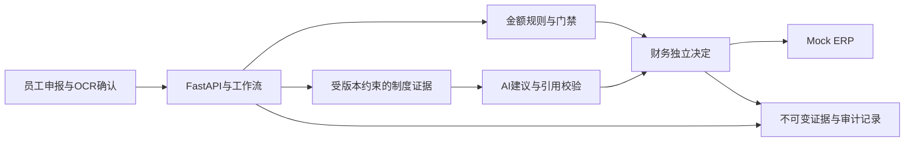

# FDE Expense AI Auditor

企业报销 AI 工作流面试项目：员工申报、票据 OCR、制度证据、确定性金额规则、AI 建议、财务决定与审计记录。

AI 提供建议，财务保留审批权。超限、证据缺失和版本冲突分别处理，模型输出不能直接授予付款权限。ERP 演示使用本地 Mock。

## 技术与代码

- React 18、TypeScript、Vite：员工、财务、管理员工作区，验证码登录，住宿矩阵发布流程。
- FastAPI、Pydantic、LangGraph：角色与公司隔离，版本及幂等控制，持久化人工审核。
- SQLite：申请、审核证据、审计记录和 Mock ERP；PostgreSQL/pgvector：制度版本和检索。
- 本地 Tesseract OCR；可选模型提供商；当前 V4 建议校验城市原文引用和请求专属证据快照。



## 公开范围

这是一个独立 Git 历史的公开代码快照。包含工程代码、回归测试和明确标记的合成测试素材；不包含内部仓库历史、私人制度原件、真实模型响应、账号凭证、数据库、预算账本或 OCR 字库。

**公开版开箱运行的是基础 Mock 演示。** 完整企业住宿/P4B 流程仍依赖未分发的制度原件及其不可变 SHA 绑定；合成制度不能冒充该原件。公开测试明确列出这些依赖并单独报告排除项。源码中存在完整企业界面，不代表这个公开包已复现录屏环境的全部能力。

没有真实模型、真实语义检索、真实 ERP 或生产上线验收的承诺。当前未授予开源许可证；公开可读不等于获得再分发许可。依赖包遵循各自许可证。

## 本地基础 Mock 演示

准备 Python 3.12、Node.js 22 或 24、npm。OCR 另需本地 Tesseract；默认启动不需要模型密钥、GPU 或 PostgreSQL。

```bash
python3.12 -m venv .venv
.venv/bin/python -m pip install -r requirements-dev.lock
.venv/bin/python -m pip install -e . --no-deps
npm ci --prefix apps/web
.venv/bin/python -m scripts.public_mock --allow-loopback-cors --api-port 8000 --web-port 5198
```

另一个终端从仓库根目录启动前端：

```bash
VITE_API_BASE=http://127.0.0.1:8000 VITE_USE_MOCK_API=false VITE_ENTERPRISE_MODE=false VITE_P4A_ENABLED=false npm run dev --prefix apps/web -- --host 127.0.0.1 --port 5198 --strictPort
```

打开 `http://127.0.0.1:5198`。基础合成单据 `CLM-2026-00004` 可演示审核、人工复核、Mock ERP 和审计。两端口须空闲；仅绑定本机，结束时停止自己启动的进程。`--allow-loopback-cors` 表示同意这次本机前后端配对；不改变系统代理、DNS 或 VPN。

## 验证

```bash
.venv/bin/python -m scripts.public_tests -q
.venv/bin/python -m ruff check .
.venv/bin/python -m pip check
npm run typecheck --prefix apps/web
node --test apps/web/tests/*.test.mjs
npm run build --prefix apps/web
```

测试范围见 [TESTING.md](TESTING.md)，本次实际结果见 [VERIFICATION.md](VERIFICATION.md)。缺少 OCR 或一次性 PostgreSQL 时会明确跳过相应测试；私有素材测试的排除项不计为通过。默认测试不调用付费模型。
