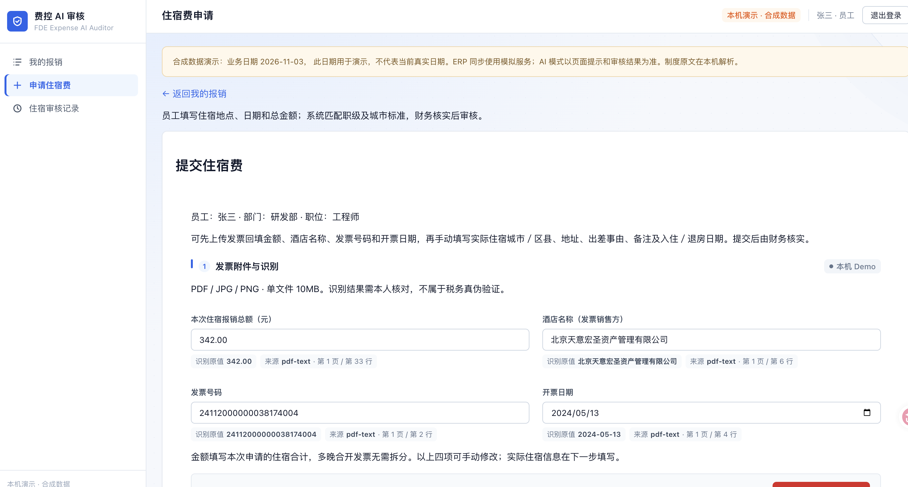
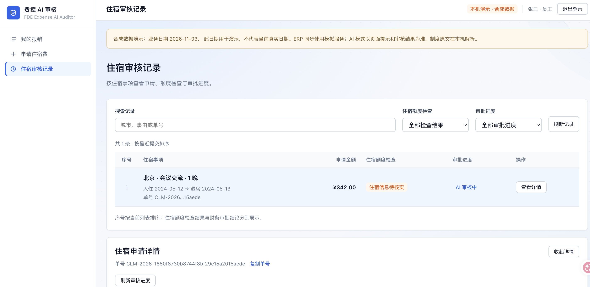
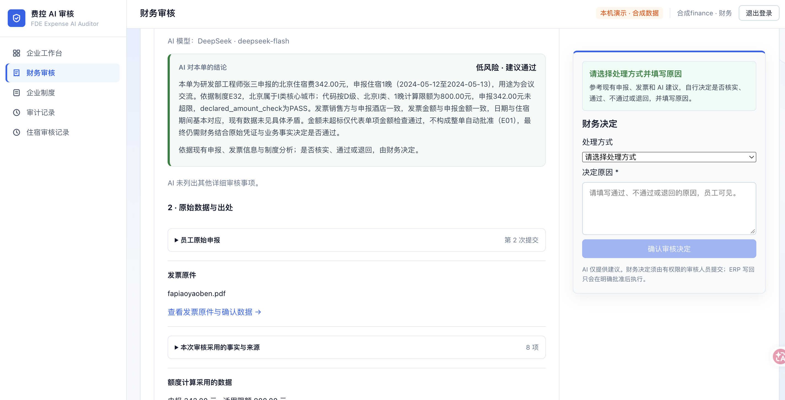
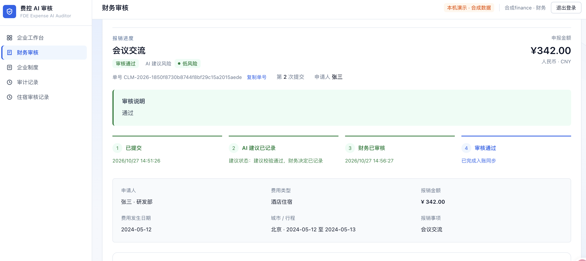
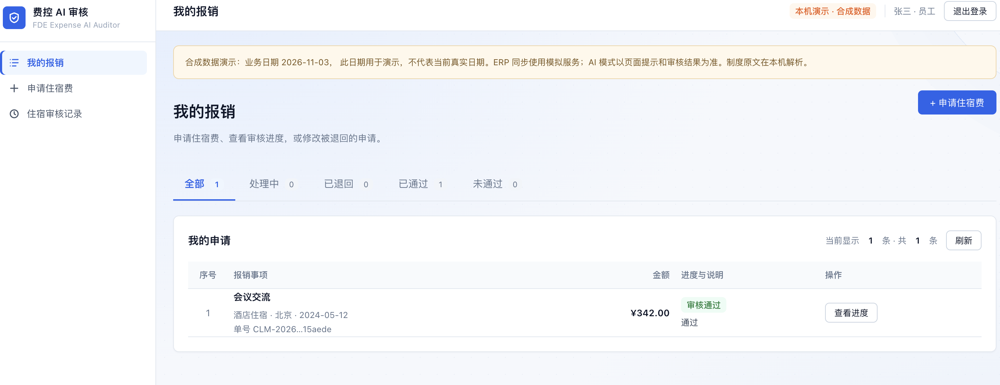
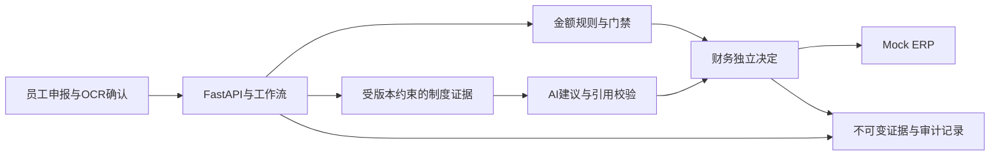

# FDE Expense AI Auditor

[](https://github.com/piaojf/fde-expense-ai-auditor-demo/actions/workflows/ci.yml)

企业报销 AI 工作流面试项目：员工申报、票据 OCR、制度证据、确定性金额规则、AI 建议、财务决定与审计记录。

AI 提供建议，财务保留审批权。超限、证据缺失和版本冲突分别处理，模型输出不能直接授予付款权限。ERP 演示使用本地 Mock。

## 这个项目展示什么

- 把模型接入业务工作流，而不是把一段聊天回复当成审批结果。
- 用确定性规则、版本化制度证据和请求级快照约束 AI 建议。
- 保留人工复核、幂等处理、Mock ERP 回执和可追溯审计记录。
- 区分公开可复现的基础演示与依赖私人制度原件的完整企业流程。

## 界面截图

以下截图来自本机企业演示环境，展示住宿申报、审核建议和财务决定。截图中的业务标识和页面状态仅用于说明演示流程；各图拍摄于不同时间。

**运行范围：** 此仓库默认提供可复现的基础 Mock 演示；截图中的完整企业住宿界面需要额外配置及未分发的制度原件，不能视为公开版开箱即用的功能。页面显示的模型名称与建议内容仅反映截图画面，不能单凭截图证明本次调用或模型语义质量。ERP 使用 Mock。

### 住宿申请与发票字段



### 员工查看住宿审核进度



### 财务查看审核建议并作决定



### 财务审核完成后的状态



### 员工查看报销结果



## 技术与代码

- React 18、TypeScript、Vite：员工、财务、管理员工作区，验证码登录，住宿矩阵发布流程。
- FastAPI、Pydantic、LangGraph：角色与公司隔离，版本及幂等控制，持久化人工审核。
- SQLite：申请、审核证据、审计记录和 Mock ERP；PostgreSQL/pgvector：制度版本和检索。
- 本地 Tesseract OCR；可选模型提供商；当前 V4 建议校验城市原文引用和请求专属证据快照。



## 公开范围

这是一个独立 Git 历史的公开代码快照。包含工程代码、回归测试、合成测试素材和上方的演示截图；不包含内部仓库历史、私人制度原件、真实模型响应文件、账号凭证、数据库、预算账本或 OCR 字库。

**公开版开箱运行的是基础 Mock 演示。** 完整企业住宿/P4B 流程仍依赖未分发的制度原件及其不可变 SHA 绑定；合成制度不能冒充该原件。公开测试明确列出这些依赖并单独报告排除项。源码中存在完整企业界面，不代表这个公开包已复现录屏环境的全部能力。

| 能力 | 公开版默认路径 | 完整企业流程 |
| --- | --- | --- |
| 基础申请 → 审核 → 人工复核 → ERP → 审计 | 合成数据、本地 Mock，可复现 | 源码保留 |
| 员工/财务/管理员、住宿矩阵、P4A/P4B | 默认关闭，不属于快速启动验收 | 需要额外配置及未分发的制度原件 |
| OCR | 可选，本机安装 Tesseract 和相应字库 | 中文还需 `chi_sim`；素材不随包分发 |
| 模型和语义检索 | 不调用付费模型，不要求 PostgreSQL | 需独立授权、预算与语义质量验证 |
| 财务付款/真实 ERP/生产部署 | 不提供；ERP 为 Mock | 不作验收承诺 |

没有真实模型、真实语义检索、真实 ERP 或生产上线验收的承诺。当前未授予开源许可证；公开可读不等于获得再分发许可。依赖包遵循各自许可证。

## 本地基础 Mock 演示

准备 Python 3.12、Node.js 22 或 24、npm。OCR 另需本地 Tesseract；默认启动不需要模型密钥、GPU 或 PostgreSQL。

```bash
git clone https://github.com/piaojf/fde-expense-ai-auditor-demo.git
cd fde-expense-ai-auditor-demo
python3.12 -m venv .venv
.venv/bin/python -m pip install -r requirements-dev.lock
.venv/bin/python -m pip install -e . --no-deps
npm ci --prefix apps/web
.venv/bin/python -m scripts.public_mock --allow-loopback-cors --api-port 8000 --web-port 5198
```

另一个终端从仓库根目录启动前端：

```bash
VITE_API_BASE=http://127.0.0.1:8000 VITE_USE_MOCK_API=false VITE_ENTERPRISE_MODE=false VITE_P4A_ENABLED=false VITE_P4B_ENABLED=false npm run dev --prefix apps/web -- --host 127.0.0.1 --port 5198 --strictPort
```

打开 `http://127.0.0.1:5198`。基础合成单据 `CLM-2026-00004` 可演示审核、人工复核、Mock ERP 和审计。两端口须空闲；仅绑定本机，结束时停止自己启动的进程。`--allow-loopback-cors` 表示同意这次本机前后端配对；不改变系统代理、DNS 或 VPN。

预期路径：打开该单据 → 执行 AI 审核 → 人工复核并通过 → 恢复处理 → 状态变为 `COMPLETED`，出现 Mock ERP 成功回执和审计事件。这里的 AI 结果来自 Mock，不代表真实模型能力。

### 常见问题

- **端口被占用**：不要结束其他项目的进程。为前后端选择另一对空闲端口，并同时更新启动参数、`VITE_API_BASE` 和浏览器地址。
- **OCR 不可用**：基础流程不依赖 OCR。需要时单独安装 Tesseract；macOS 可用 `brew install tesseract`，Ubuntu 可用 `sudo apt-get install tesseract-ocr tesseract-ocr-eng`。中文识别另需中文语言包。
- **看不到企业登录或住宿流程**：这是公开基础模式的预期行为，不能通过切换前端开关绕过私人制度来源校验。
- **重复演示同一单据**：先停止自己启动的服务，再重新运行 `scripts.public_mock`；它使用独立临时数据，不会清空已有业务数据库。

## 验证

```bash
.venv/bin/python -m scripts.public_tests -q
.venv/bin/python -m ruff check .
.venv/bin/python -m pip check
npm run typecheck --prefix apps/web
npm test --prefix apps/web
npm run build --prefix apps/web
```

测试范围见 [TESTING.md](TESTING.md)，发布快照的历史本地结果见 [VERIFICATION.md](VERIFICATION.md)，最新提交以 [Actions 实际运行](https://github.com/piaojf/fde-expense-ai-auditor-demo/actions/workflows/ci.yml)为准。缺少 OCR 或一次性 PostgreSQL 时会明确跳过相应测试；私有素材测试的排除项不计为通过。默认测试不调用付费模型。

如已安装 Chrome，可运行完整基础浏览器闭环（需要空闲的 8000/5198 端口）：

```bash
.venv/bin/python -m scripts.public_e2e --allow-loopback-cors --chrome "/path/to/chrome"
```

macOS Chrome 路径通常为 `/Applications/Google Chrome.app/Contents/MacOS/Google Chrome`，Ubuntu 通常为 `/usr/bin/google-chrome`。Playwright Core 随 `npm ci` 安装，但不下载浏览器。脚本只启动、清理自己的进程；结果、截图和日志保存在忽略提交的 `output/ci/public-e2e/`。

## PR、CI 与发布

PR 和 `main` 提交运行三路检查：Python 公开测试、前端类型/测试/构建/高危依赖审计、真实 Chrome 的基础 Mock 闭环；`Required CI` 汇总结果，任何一路失败或跳过都会阻止其通过。

手动 Release 流程仅接受当前 `main` 上已存在的 `vX.Y.Z` 标签，重新执行 CI，再发布源码、基础前端压缩包和 SHA-256 校验文件。**不自动部署网站，也不连接真实 ERP。** 具体权限、分支保护、依赖更新和发布步骤见 [CI/CD 说明](docs/ci-cd.md)。
